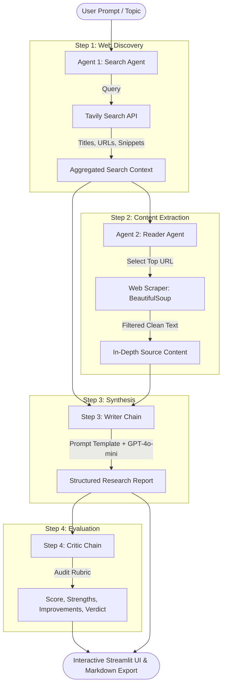

<div align="center">

# 🔬 ResearchMind
### Autonomous Multi-Agent AI Research & Analysis Engine

An intelligent, multi-agent AI research assistant built with LangChain, OpenAI (`gpt-4o-mini`), Tavily Search, and Streamlit. ResearchMind coordinates specialized AI agents to autonomously gather web sources, extract deep textual content, synthesize structured analytical reports, and perform rigorous quality critique.

[](https://www.python.org/)
[](https://www.langchain.com/)
[](https://openai.com/)
[](https://tavily.com/)
[](https://streamlit.io/)
[](LICENSE)

[Key Features](#-key-features) •
[System Architecture](#-system-architecture) •
[Quickstart](#-quickstart-guide) •
[CLI Usage](#-cli-usage) •
[Configuration](#-configuration-reference) •
[Project Structure](#-project-structure) •
[Contributing](#-contributing)

---

</div>

## 🌟 Key Features

- **Autonomous Multi-Agent Collaboration**: Four specialized agents and chains work sequentially to transform a raw user topic into a verified, publication-ready research report.
- **Real-Time Web Intelligence**: Integrates the Tavily Search API to bypass search engine clutter and retrieve high-relevance sources, titles, and snippets.
- **Deep Web Extraction**: Built-in reader agent scrapes primary URLs with `BeautifulSoup`, stripping noise (scripts, CSS, navbars, footers) to extract pure textual signal.
- **Structured Synthesis Chain**: Generates comprehensive reports with an Executive Introduction, Key Findings (detailed explanations), Strategic Conclusions, and complete source attribution.
- **Automated Critic & Evaluation Scorecard**: An independent evaluation chain audits the drafted report, assigning an objective score out of 10, highlighting key strengths, flagging areas to improve, and providing a final verdict.
- **Modern Dark-Mode UI**: Built with Streamlit, custom CSS, live execution indicators, expandable inspect panels for raw search and scraped data, and one-click Markdown (`.md`) export.
- **Dual Execution Modes**: Run effortlessly through the interactive web dashboard or directly in your terminal via the standalone CLI pipeline.

---

## 🏗️ System Architecture

ResearchMind uses a directed multi-agent pipeline where each step isolates a distinct responsibility:



### Agent Roles & Specifications

| Agent / Chain | Engine | Functionality | Primary Tool |
| :--- | :--- | :--- | :--- |
| **Search Agent** | `gpt-4o-mini` | Formulates targeted queries and gathers top 5 reliable web sources | `web_search` (Tavily API) |
| **Reader Agent** | `gpt-4o-mini` | Selects the most authoritative source URL and extracts rich body content | `scrape_url` (Requests + BeautifulSoup) |
| **Writer Chain** | `gpt-4o-mini` | Synthesizes search results and scraped content into a multi-section structured report | LangChain LCEL + Prompt Template |
| **Critic Chain** | `gpt-4o-mini` | Evaluates report accuracy, structure, depth, and provides an objective score ($X/10$) | LangChain LCEL Evaluation Prompt |

---

## 🚀 Quickstart Guide

### 1. Prerequisites

- **Python**: Version `3.10` or higher
- **OpenAI API Key**: For model inference (`gpt-4o-mini`). [Get an OpenAI Key](https://platform.openai.com/api-keys)
- **Tavily API Key**: For autonomous web search. [Get a Free Tavily Key](https://tavily.com/)

---

### 2. Clone the Repository

```bash
git clone https://github.com/itendra-kumar-dev/Multi-Agent-System.git
cd Multi-Agent-System
```

---

### 3. Create & Activate a Virtual Environment

**macOS / Linux:**
```bash
python3 -m venv .venv
source .venv/bin/activate
```

**Windows (PowerShell):**
```powershell
python -m venv .venv
.venv\Scripts\Activate.ps1
```

---

### 4. Install Dependencies

```bash
pip install --upgrade pip
pip install -r requirements.txt
```

---

### 5. Configure Environment Variables

Copy the provided template and add your API keys:

```bash
cp .env.example .env
```

Edit `.env` with your preferred editor:

```env
OPENAI_API_KEY=sk-proj-...
TAVILY_API_KEY=tvly-...
```

> [!CAUTION]
> Never commit your real `.env` file to version control. The repository's `.gitignore` protects against accidental leakage.

---

### 6. Launch the Streamlit Web Application

```bash
streamlit run app.py
```

The application will launch in your browser at `http://localhost:8501`. Enter any research topic and click **⚡ Run Research Pipeline** to watch the agents execute in real time.

---

## 💻 CLI Usage

If you prefer running research sessions in your terminal without a graphical interface:

```bash
python pipeline.py
```

You will be prompted to enter a topic. The pipeline will print formatted progress steps, intermediate outputs, the final report, and the critic's review directly to the terminal.

---

## ⚙️ Configuration Reference

| Environment Variable | Required | Description |
| :--- | :---: | :--- |
| `OPENAI_API_KEY` | **Yes** | Authenticates requests to OpenAI for `gpt-4o-mini` agent reasoning, report drafting, and critique. |
| `TAVILY_API_KEY` | **Yes** | Authenticates real-time web search requests through the Tavily Search API. |

---

## 📁 Project Structure

```text
Multi-Agent-System/
├── .github/
│   ├── ISSUE_TEMPLATE/
│   │   ├── bug_report.md          # Standard bug report template
│   │   └── feature_request.md     # Feature suggestion template
│   ├── pull_request_template.md   # Pull request submission checklist
│   └── workflows/
│       └── ci.yml                 # Automated CI build & syntax testing
├── .env.example                   # Environment configuration template
├── .gitignore                     # Production Python gitignore
├── agents.py                      # Multi-agent definitions, prompts & LCEL chains
├── app.py                         # Streamlit dark-mode web application
├── CONTRIBUTING.md                # Contribution workflow and guidelines
├── LICENSE                        # MIT Open Source License
├── pipeline.py                    # Sequential CLI research pipeline
├── README.md                      # Comprehensive project documentation
├── requirements.txt               # Pinned project dependencies
├── SECURITY.md                    # Security vulnerability reporting policy
└── tools.py                       # Search and web scraping tool implementations
```

---

## 🔍 Troubleshooting

| Issue | Root Cause | Solution |
| :--- | :--- | :--- |
| **`AuthenticationError` (OpenAI)** | Missing or invalid `OPENAI_API_KEY` | Ensure `OPENAI_API_KEY` is defined in `.env` and valid on platform.openai.com. |
| **`Tavily API error`** | Missing or exhausted `TAVILY_API_KEY` | Check your Tavily quota and ensure the key is correctly set in `.env`. |
| **`ModuleNotFoundError: No module named 'streamlit'`** | Dependencies not installed in active environment | Activate your `.venv` and run `pip install -r requirements.txt`. |
| **Scraper returns empty content** | Target web page requires JavaScript or blocks scraping | The reader agent gracefully falls back to the search snippet when a page cannot be scraped. |

---

## 🤝 Contributing

Contributions are warmly welcomed! Please read our [Contributing Guidelines](CONTRIBUTING.md) and [Code of Conduct](CONTRIBUTING.md#-code-of-conduct) before opening a pull request.

1. Fork the Project
2. Create your Feature Branch (`git checkout -b feature/AmazingFeature`)
3. Commit your Changes (`git commit -m 'feat: add AmazingFeature'`)
4. Push to the Branch (`git push origin feature/AmazingFeature`)
5. Open a Pull Request

---

## 📄 License

Distributed under the **MIT License**. See [`LICENSE`](LICENSE) for more information.

---

## 👤 Author & Acknowledgments

- **Author**: [Jitendra Kumar](https://github.com/itendra-kumar-dev)
- **Frameworks**: [LangChain](https://github.com/langchain-ai/langchain), [Streamlit](https://streamlit.io/), [Tavily](https://tavily.com/), [OpenAI](https://openai.com/)

<div align="center">
  <sub>Built with ❤️ by Jitendra Kumar</sub>
</div>
